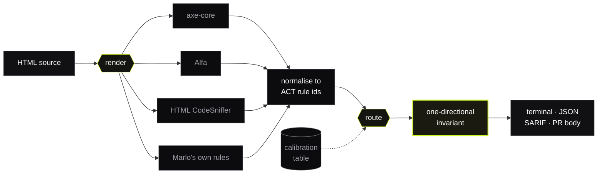
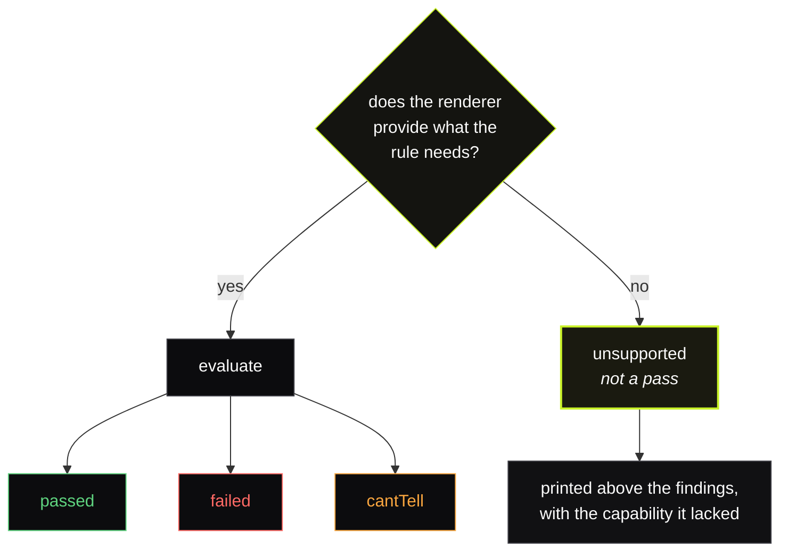

# Marlo

**Our false positive rate is 8.7%. Here is how we measured it, and why we are printing it.**

[](https://github.com/KarthikSubramanian07/Marlo/actions/workflows/ci.yml)
[](calibration/README.md)
[](calibration/ANALYSIS.md)
[](LICENSE)

Every accessibility tool claims to be accurate. Not one of them will tell you how often it is wrong.

Marlo will. It checks pages against the [official W3C ACT rule corpus](https://act-rules.github.io), then measures itself against that same corpus and commits the result to this repository. The numbers are regenerated in CI on every push. When one moves and nobody said why, the build fails.

That figure is what `marlo scan` reports, measured as a whole over the 41 rules it evaluates. Until recently this line printed 5.6%, which is the rate of Marlo's own rule engine, one component of the product. The product reports a failure whenever any of its four engines does, and that costs precision. [HONESTY.md entry 17](HONESTY.md#17-the-front-page-measured-a-component-and-the-routing-was-graded-on-its-own-answers).

**[trymarlo.pages.dev](https://trymarlo.pages.dev)** · [try it in your browser](https://trymarlo.pages.dev/try/) · [the numbers](calibration/README.md) · [where Marlo was wrong](HONESTY.md)

**Try it without installing anything.** Give the [playground](https://trymarlo.pages.dev/try/) a web address, a GitHub repository or some HTML, and Marlo's own rules check it in your browser, with each rule's measured precision beside every finding. The same page has a bookmarklet that checks any page you open. For the full four-engine scan, `docker run --rm -v "$PWD:/work" ghcr.io/karthiksubramanian07/marlo scan page.html`.

---

## The table nobody else publishes

Four engines, 513 official test case outcomes, one code path, no exemptions.

| Engine           | Rules  | Precision | Recall    | False positives |
| ---------------- | ------ | --------- | --------- | --------------- |
| Alfa             | 40     | 0.964     | 0.835     | **1.5%**        |
| axe-core         | 38     | 0.952     | 0.777     | 2.0%            |
| **Marlo**        | **41** | **0.853** | **0.640** | **5.6%**        |
| HTML CodeSniffer | 12     | 0.684     | 0.366     | 9.4%            |

Marlo is third of four. Alfa and axe-core are both more precise and more sensitive, and the router sends 18 rules to axe-core against 20 to Marlo's own engine.

Nobody edited that. Marlo's engine goes through the same harness, on the same corpus, with no special case, because a table where the author's own engine happened to win would be worth exactly nothing. That is [D-008](DECISIONS.md#d-008), and it is the reason to believe any other number here.

### What the product reports, and what routing does on cases it has not seen

The table grades each engine on each rule. The router picks an engine per rule from those same grades, so scoring "the engine the router picked" on those cases is grading it on its own answers. [calibration/ANALYSIS.md](calibration/ANALYSIS.md) scores everything case by case instead, over the 41 rules `marlo scan` evaluates and 568 official cases, with each routing decision recomputed without the case being scored. Every figure carries a 95% Wilson interval.

| Over what marlo scan evaluates | Precision              | Recall                 | False positives    |
| ------------------------------ | ---------------------- | ---------------------- | ------------------ |
| What marlo scan reports        | 0.831 (0.772 to 0.877) | 0.853 (0.795 to 0.896) | 8.7% (6.3 to 12.0) |
| Routed engine, leave one out   | 0.933 (0.882 to 0.963) | 0.737 (0.670 to 0.794) | 2.6% (1.4 to 4.8)  |
| Routed engine, in sample       | 1.000 (0.974 to 1.000) | 0.763 (0.698 to 0.818) | 0.0% (0.0 to 1.0)  |
| Majority of engines            | 0.931 (0.877 to 0.962) | 0.705 (0.637 to 0.765) | 2.6% (1.4 to 4.8)  |
| Alfa alone                     | 0.960 (0.915 to 0.981) | 0.753 (0.687 to 0.809) | 1.6% (0.7 to 3.4)  |
| axe-core alone                 | 0.954 (0.904 to 0.979) | 0.658 (0.588 to 0.722) | 1.6% (0.7 to 3.4)  |
| Marlo alone                    | 0.853 (0.781 to 0.904) | 0.579 (0.508 to 0.647) | 5.0% (3.2 to 7.7)  |

Three things this says, and none of them flatters the design.

**The routed engine's perfect precision was an artifact.** Held out, it falls to 0.933, and holding a single case out changes the router's choice on 16 of 709 cases across every routed rule. Routed this way, it scores below running Alfa everywhere on both precision and recall, though the intervals overlap.

**The product detects the union.** Because no engine may be silenced, a rule fails whenever any engine fails it, which gives the highest recall here and the highest false positive rate apart from HTML CodeSniffer alone. That trade is deliberate: a violation one engine can see is a violation, and the cost of reporting it is printed above rather than hidden.

**What routing buys is not accuracy.** It decides which engine's evidence, locator and measured confidence a finding carries, so each failure is reported once with provenance, and it decides what a clean result rests on. Whether routing could also raise accuracy is a question this table cannot answer. Scored on the rated real pages below, it does not.

### The same corpus, inside a real browser

The table above is measured with no browser, so anyone can reproduce it from a clean clone. The same harness also runs every engine inside Chromium, which is the only way to evaluate the rules that need layout, contrast among them. Those numbers are published beside the headline, never in place of it, in [calibration/BROWSER.md](calibration/BROWSER.md).

Under Chromium, 590 test case outcomes are graded, because the layout cases become measurable.

| Engine, in Chromium | Rules  | Precision | Recall    | False positives |
| ------------------- | ------ | --------- | --------- | --------------- |
| axe-core            | 38     | 0.964     | 0.906     | 1.6%            |
| Alfa                | 40     | 0.960     | 0.862     | 1.7%            |
| **Marlo**           | **41** | **0.858** | **0.630** | **5.0%**        |
| HTML CodeSniffer    | 12     | 0.622     | 0.394     | 13.0%           |

Still third of four. On minimum contrast, which every scan before this reported as not evaluated, Marlo computes the ratio from a paint-order walk and has not flagged a passing case, and every failing case it misses is one where it says it cannot tell rather than guess: text on an image or a gradient, or inside a shadow root it does not enter.

### A second corpus, from real pages

Every number above comes from hand-written test cases, each built to isolate one condition. Real pages are not like that, so `corpus/real` vendors 25 pages from 12 kinds of site (government, documentation, shops, checkouts, forms, application shells and more), all under licences that allow it, and the harness measures every engine on them separately and never pools the result with the table above.

Every one of the 1025 cells, each page against each rule Marlo implements, now has a resolved ground truth. **It is model-adjudicated, not human judgment**: two different language models rated every cell independently, blind to every engine, and a third settled the 38 cells where they disagreed. They agreed on 94.8% of the 738 cells that needed a judgment (Cohen's kappa 0.890). How far to trust that is measured rather than assumed: the same raters, under the same instructions, rated the 594 official test cases of the same rules with their names hidden, and the adjudicated labels match the W3C's human-written answers on 95.8% of them ([RATER-VALIDITY.md](corpus/real/adjudication/RATER-VALIDITY.md)). D-014 in [DECISIONS.md](DECISIONS.md) records why, and what would make the figures below wrong.

On real pages the picture is much worse than on the official cases:

| Real pages, 1023 resolved cells | Precision | Recall    | False positives |
| ------------------------------- | --------- | --------- | --------------- |
| **What `marlo scan` reports**   | **0.582** | **0.570** | **4.1%**        |
| Alfa alone                      | 0.737     | 0.452     | 1.6%            |
| axe-core alone                  | 0.882     | 0.161     | 0.2%            |
| Routed engine                   | 0.528     | 0.204     | 1.8%            |
| Marlo's own engine alone        | 0.372     | 0.172     | 2.9%            |

Precision falls from 0.831 to 0.582 and recall from 0.853 to 0.570. The routing chosen on the official corpus, scored on pages it never saw, finds a third as many violations as the union and is no more precise, which settles the open question above: routing is not an accuracy mechanism. And Marlo's own engine, third of four on the official cases, is the least precise engine on real ones. Intervals and the full table are in [calibration/ANALYSIS.md](calibration/ANALYSIS.md). Beyond accuracy, on 19 of the 25 pages some engine reports a failure for a rule the routed engine passes, and engines that agree closely on the official cases report findings at rates two orders of magnitude apart.

Why Marlo's own engine does so badly is written down cell by cell in [calibration/ERROR-ANALYSIS.md](calibration/ERROR-ANALYSIS.md). It makes 27 false positives and 43 false negatives on rules it evaluates, and each has a named root cause. 17 of the false positives are rule logic that contradicts the ACT rule text, 8 of them from one defect: failing an ID reference whose target is missing, which the rule explicitly allows. 24 of the false negatives are abstentions, mostly on bypass rules that turn on what repeats across a site. Five rules with real-page errors score perfectly on their official test cases, because no case exercises what fails. Rerun in headless Chromium, the engine's precision is 0.733 and its recall 0.473. Fixing rules on these pages and measuring them here again would make the pages training data, so the fixes are measured on a second set of pages instead.

### A third corpus, held out

`corpus/heldout` vendors 25 more pages from 12 kinds of site, none from a site `corpus/real` uses (the verifier refuses one that is), snapshotted and rated the same way. Their ground truth was committed, and pushed, before any rule change made after the error analysis was measured on them, so they say how well a correction generalises rather than how well it fits the pages it was written against. The same two raters rated every held-out cell independently and the same resolver decided where they differed: agreement was 96.5% over the 750 cells that needed a judgment, a kappa of 0.931, with 26 cells left to the resolver.

Every engine on the held-out cells, graded strictly and pooled over the rules it claims, with the rules as they stood when that ground truth was committed:

| Held-out pages, every engine | Precision | Recall |
| ---------------------------- | --------- | ------ |
| Alfa                         | 0.862     | 0.694  |
| axe-core                     | 0.824     | 0.333  |
| HTML CodeSniffer             | 0.381     | 0.138  |
| Marlo's own engine           | 0.680     | 0.304  |

These pool each engine over its own rules, so they are not the per-strategy figures in the table above, and every cell an engine declined or crashed on counts as a miss. The intervals are in [calibration/README.md](calibration/README.md#held-out-real-pages).

---

## Why this is the product

Lighthouse returns 100 on pages a screen reader cannot get through. A major AI site builder shipped an unusable product and its own bundled checker reported perfection. The best-funded vendor in the category advertises "19x more critical issues" without defining the term. The overlay industry asserted compliance until a regulator turned up with a fine.

None of that happened because detection is hard. It happened because **an unverifiable claim costs nothing to make.**

So Marlo's differentiator is not better fixes. It is that its error rate is a number you can look up, recompute, and file a dispute about.

---

## What using it looks like

This is recorded output, not a mock-up: every line below appears verbatim in `tests/golden/checkout-terminal.txt`, which the end to end suite regenerates from a real scan of the deliberately broken demo page, and a test fails if the excerpt drifts from it.

```
$ marlo scan apps/demo/checkout.html apps/demo/settings.html

apps/demo/checkout.html
  static renderer  dom, script

  NOT EXAMINED  2 rules need layout and paint, which this renderer does not provide.
                09o5cg afw4f7
                This is not a pass. Use --renderer browser to evaluate them.

  ▲▲▲ critical e086e5  Form field has non-empty accessible name
      WCAG 1.3.1, 2.5.3, 4.1.2  axe-core precision 1.00 over 17 official test cases
      input (not located in source)
        INVARIANT marlo failed this element and the routed engine did not report it: axe-core says passed, alfa says passed.
        The field has no accessible name, so it is announced only by its type. A placeholder ("Email") is not a label: it disappears on focus and is not reliably announced.
      div[role="slider"] (not located in source)
        ARIA input fields must have an accessible name

  ▲▲  serious  afw4f7  Text has minimum contrast
      WCAG 1.4.3, 1.4.6  alfa precision 0.83 over 28 official test cases
      INVARIANT alfa reported a failure the routed engine did not, so Marlo may not report clean.
      disagreement: alfa says failed
      disagreement: htmlcs says passed
      xpath /html[1]/body[1]/main[1]/p[1]/text()[1] (not located in source)
        The highest possible contrast of the text is 3.45:1 which is below the required contrast of 4.5:1

  ------------------------------------------------------------------------
  39 findings   0 fixed   0 flagged   2 not evaluated   0 crashed
  coverage: 41 of 94 published ACT rules
  one-directional invariant enforced on 3 rule(s): a peer reported a failure the routed engine did not.
```

Three things there that most scanners will not show you.

**What it could not check, before what it found.** Two rules need CSS layout, the default renderer has none, and it says so above the findings rather than in a footnote. "No contrast problems were found" and "contrast was not examined" are different sentences. Run it with `--renderer browser` and both rules are evaluated.

**Where the confidence came from.** `axe-core precision 1.00 over 17 official test cases`. Go and disagree with it.

**A disagreement between engines, on the record, down to the element.** The calibration table routes `e086e5` to axe-core, which fails five other form controls on this page and passes the email input whose only label is a placeholder. Marlo's own rule fails it. The routed engine decides who speaks for the rule, and it still may not silence a peer about a single element, so that field is listed first, marked, with the engines that disagreed named. On contrast the routed engine reported nothing at all, so the whole rule was forced through on Alfa's word.

Severity is a text mark, never colour on its own, so the output survives a pipe, a CI log, and a reader who cannot tell red from amber.

---

## Five minutes, from nothing

```bash
git clone https://github.com/KarthikSubramanian07/Marlo.git
cd Marlo
pnpm install
pnpm check                          # Everything CI runs. No network, no API key, no browser.
pnpm build && node packages/cli/dist/bin.js scan your-page.html
```

If any of that needs the network after `install`, it is a bug. The whole suite runs offline against a vendored corpus, and that is the only reason the offline claim in this README is worth reading.

|                        |                                                                         |
| ---------------------- | ----------------------------------------------------------------------- |
| `pnpm check`           | Everything CI runs                                                      |
| `pnpm calibrate`       | Regenerate the accuracy table (about three minutes)                     |
| `pnpm calibrate:check` | The CI gate: fails on a regression **and** on an unrecorded improvement |
| `pnpm corpus:verify`   | Prove the 1134 vendored test cases are unmodified                       |
| `pnpm screenshots`     | Capture the site at iPhone, iPad and laptop widths, and audit it        |
| `pnpm run deploy`      | Build the site and ship it                                              |

---

## How it actually works



The two accented boxes are the seams, and the thick one is the rule that can override everything upstream of it.

**Marlo reports every engine's failures once, with provenance. It does not pile them up and call the pile thorough.**

There was a project that integrated ten engines and around a thousand rules. Published at SIGACCESS, adopted inside a Fortune 50 company, reached almost nobody. The research it cites explains why: accessibility engines find largely _disjoint_ issue sets with poor agreement, and handing somebody ten engines' raw output gives them a triage problem, which is worse than the detection problem they started with.

Marlo's detection is still the union of its engines, because the rule below forbids silencing any of them, and the measured cost of that is the 8.7% at the top of this page. What it does instead of piling is deduplicate: the calibration table decides which engine reports each rule, a failure is listed once against the element it names, and every finding carries the engine that reported it, the engines that agreed or dissented, and that engine's measured accuracy on the rule. [D-003](DECISIONS.md#d-003).

**Routing decides who speaks. It does not let anyone silence a peer.** If any engine reports a failure, Marlo may not report clean. It can dissent, on the record, with the disagreeing engine named.

| The routed engine says | A peer says | Marlo reports |                                        |
| ---------------------- | ----------- | ------------- | -------------------------------------- |
| failed                 | anything    | **failed**    | agreement, or the routed engine alone  |
| passed                 | **failed**  | **failed**    | the invariant fires, the peer is named |
| cantTell               | **failed**  | **failed**    | the invariant fires                    |
| passed                 | cantTell    | passed        | caution is not evidence                |
| unsupported            | anything    | never a pass  | the renderer could not look            |

Tested over all **256** combinations of four engines and four outcomes, because an invariant checked by three examples is an anecdote. The file is held at 100 percent coverage on every metric, and two of its branches were deleted rather than tested when they turned out to guard states the schema now forbids.

**A rule declares what it needs; a renderer declares what it has.** A rule whose needs are unmet reports `unsupported`, which is never a pass anywhere in the codebase. That one rule is what lets the default path run with no browser at all without quietly claiming coverage it does not have. [D-005](DECISIONS.md#d-005).



There is no arrow from the right-hand branch back to `passed`. That absence is the whole design: the type system has no way to turn "could not look" into "looked and it was fine".

It is enforced structurally rather than by review. The suite runs every rule twice, once with resolved styles and once without, and fails if a rule that did not declare `layout` changes its verdict.

axe-core reached the same conclusion independently, which was a pleasant surprise: run over all 19 test cases for the minimum-contrast rule under the same Node DOM, it returned "cannot tell" every time and "failed" never, because the colours cannot be resolved without layout.

---

## The finding that reshaped the project

W3C defines how to grade an implementation against a rule's official test cases. Under that protocol, `cantTell` is an allowed answer for **every** example type.

So a tool that answers "cannot tell" to all 1134 test cases is, officially, a correct implementation of all 91 rules that have them.

That is not a flaw in the protocol. It grades whether a tool _misleads_ you, and "I don't know" misleads nobody. It is simply not the question a developer is asking, which is whether the violation will actually be found.

So the calibration table publishes **both** views and computes the gap. Nine entries currently grade as officially `consistent` while missing more than half the violations a real user would hit:

| ACT rule | Engine    | W3C verdict | Strict recall |
| -------- | --------- | ----------- | ------------- |
| `36b590` | **Marlo** | consistent  | 0.000         |
| `5c01ea` | **Marlo** | consistent  | 0.000         |
| `c487ae` | **Marlo** | consistent  | 0.273         |
| `cf77f2` | **Marlo** | consistent  | 0.000         |
| `ye5d6e` | **Marlo** | consistent  | 0.333         |
| `3ea0c8` | axe-core  | consistent  | 0.000         |
| `4b1c6c` | Alfa      | consistent  | 0.000         |
| `b20e66` | Alfa      | consistent  | 0.000         |
| `fd3a94` | Alfa      | consistent  | 0.000         |

Five of the nine are ours. Under the protocol W3C publishes implementation reports against, Marlo is a **correct implementation** of `5c01ea` while detecting nothing at all. [D-004](DECISIONS.md#d-004).

---

## Eight ways in, one set of numbers

|                   |                                                              |                                                                          |
| ----------------- | ------------------------------------------------------------ | ------------------------------------------------------------------------ |
| **Playground**    | [trymarlo.pages.dev/try](https://trymarlo.pages.dev/try/)    | Marlo's own rules on a URL, a repository or pasted HTML, in your browser |
| **Bookmarklet**   | On the same page                                             | The same rules on any page you open, in a panel beside it                |
| **Docker**        | `ghcr.io/karthiksubramanian07/marlo`                         | The CLI with nothing else installed; amd64 and arm64                     |
| **CLI**           | `marlo scan`, `explain`, `coverage`                          | Exits 1 on findings, 3 on a rule it could not evaluate                   |
| **Library**       | `@trymarlo/cli`, `@trymarlo/report`                          | The pipeline and the surfaces, importable; on npm from the first release |
| **SARIF 2.1.0**   | `--sarif`                                                    | Per-engine provenance on every result, for the code scanning tab         |
| **GitHub Action** | [`.github/actions/marlo`](.github/actions/marlo)             | Read-only by default; an opt-in mode opens a pull request                |
| **MCP**           | [`@trymarlo/mcp`](packages/mcp), or `trymarlo.pages.dev/mcp` | Three read-only tools. No `fix` tool, and there will not be one          |

The playground and the bookmarklet run only Marlo's own engine, so they find less than the CLI: no axe-core, Alfa or HTML CodeSniffer, no routing, and no invariant. They say so on the page. The Action and MCP are where the safety promise stops being prose. In an Action, what Marlo may write is a statement about a permission, so the Action reads the permissions it was handed before it does anything. By default it refuses any token that can write to the repository. With `open-pull-request: true` it requires exactly `contents: write` and `pull-requests: write`, refuses every other write scope, applies only fixes that cleared the measured gate and verified, and opens one pull request whose branch name is derived from the edits, so a second run over the same state opens nothing. It refuses to write to the default branch, never force-updates a ref, and never merges. The body carries, per fix, the measurement the decision rested on and the three verification answers, and per refusal the number that disqualified it. Over MCP, a model calls tools with no human in between, so the server has no tool that writes and a test asserts the package does not import `writeFileSync` at all.

---

## Where it will not help you

- **It is not comprehensive and never says it is.** 41 of 94 published ACT rules, and automation reaches a minority of WCAG regardless.
- **It will not recolour your design.** Contrast is detected and located, never changed.
- **It will not invent alt text.** Decorative images get an empty alt confidently. A description is written only where the page already supplies the meaning. Everything else comes back to you, because a confident wrong description is worse than an absent one: you can notice an absence. [D-009](DECISIONS.md#d-009).
- **It cannot certify anything.** Nobody can. You get verified repair against named success criteria and a published error rate.
- **Repair covers seven rules, and applies two of them.** `marlo fix` has codemods for seven, and on the current table only two clear the accuracy gate. The other five arrive as flags with the generated change attached and the precision that disqualified it. A gate that admits everything is not a gate.

## What it will never do

**Marlo will never sell remediation services, and never sell a conformance report to anyone it rates.**

Every incumbent that both rates and remediates has a commercial reason to find problems it can be paid to fix. Independence is the only asset a measurement tool has, and it is not the sort of thing you get back after you spend it.

It also never merges its own pull requests, never pushes to your default branch, never force pushes, and never deploys. Enforced in the requested token scopes and asserted by tests, not promised in prose. [SECURITY.md](SECURITY.md).

---

## Contributing: the shortest path is telling us we were wrong

**[Report a false positive.](https://github.com/KarthikSubramanian07/Marlo/issues/new?template=false-positive.yml)** The most valuable message this project can receive, and deliberately the easiest thing to do here. You do not need to know which ACT rule fired or which engine reported it. Every confirmed one becomes a fixture, so the same mistake fails the build afterwards.

**[Implement a rule.](https://github.com/KarthikSubramanian07/Marlo/issues?q=is%3Aissue+is%3Aopen+label%3Atype%3Anew-rule)** One file, one registry line, one fixture set. The backlog is sized so each one is an afternoon, and you should not need to read the pipeline; if you do, that is a bug in the rule interface and worth its own issue.

A rule that measures badly still gets merged. It is published with its real numbers and the router sends that rule to a better engine. What cannot be merged is a rule with **no** measurement, because then the table would hold an assertion instead of a fact.

**[Dispute a number.](https://github.com/KarthikSubramanian07/Marlo/issues/new?template=calibration-dispute.yml)** A published figure being wrong is a defect in the thing this project is for, so it outranks a feature request.

[CONTRIBUTING.md](CONTRIBUTING.md) · [CREDITS.md](CREDITS.md) · sign off with `git commit -s` ([DCO, not a CLA](DECISIONS.md#d-001), because putting a legal document in front of an annoyed bug reporter is how you lose the report) · [credit stays with Git Author](DECISIONS.md#d-013)

---

## Reading order, if you have twenty minutes

|                                                |                                                                                    |
| ---------------------------------------------- | ---------------------------------------------------------------------------------- |
| [RESEARCH.md](RESEARCH.md)                     | What was measured before any code was written, and the eight things it rules out   |
| [DECISIONS.md](DECISIONS.md)                   | Fifteen decisions, each stating what would make it wrong                           |
| [HONESTY.md](HONESTY.md)                       | Seventeen entries. Every defect found during the build, with what reported success |
| [calibration/README.md](calibration/README.md) | The generated table, per rule, per engine                                          |
| [ARCHITECTURE.md](ARCHITECTURE.md)             | How a page moves through the pipeline                                              |
| [HANDOFF.md](HANDOFF.md)                       | What is real, what is stubbed, what is deferred, and the traps                     |

`HONESTY.md` existed before the product did. It is not a postmortem, it is a design constraint: a project whose claim is "we tell you when we are wrong" needs somewhere to write that down before it has anything to be wrong about.

---

## Built on

[axe-core](https://github.com/dequelabs/axe-core) (MPL-2.0, unmodified) · [Alfa](https://github.com/Siteimprove/alfa) (MIT) · [HTML CodeSniffer](https://github.com/squizlabs/HTML_CodeSniffer) (BSD-3-Clause) · [happy-dom](https://github.com/capricorn86/happy-dom) (MIT) · the [ACT-Rules Community corpus](https://act-rules.github.io) (W3C Software and Document Licence)

Marlo's epistemology, its one-directional invariant, its alt-text policy and five of its tests are lifted from [`krishaygarg/ada_pdf_remediation`](https://github.com/krishaygarg/ada_pdf_remediation), a sibling project that does this for PDFs and documents three cases where its own auditor confirmed its own bugs. Full obligations in [docs/licenses.md](docs/licenses.md).

MIT. The repository is public because an unauditable verifier is a contradiction: "trust our error rate" is the same sentence as "trust our compliance score", and that sentence is the reason this exists.
